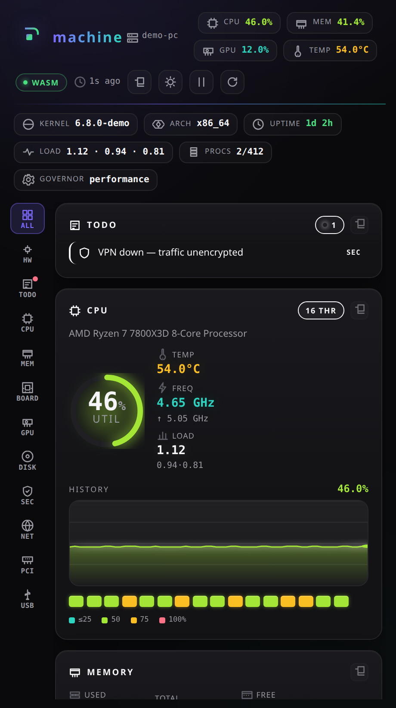

# machine

Compact live hardware monitor: CPU, memory, board, GPU, disks, security,
network, PCI/USB in one small desktop window. Rust parsers → WebAssembly, app on
[Deno](https://deno.com) + [aio](https://github.com/riagentic/aio). Runs on
**Linux, Windows and macOS** (CI-tested on all three).



## Features

- 🧠 Live per-second CPU chart, per-core heat grid, temps, frequency, load
- 🧾 **HW** tab: full hardware inventory (CPU, RAM sticks, board/BIOS, GPUs,
  drives, network, PCI, USB) on one card
- 🩺 **Todo**: what's not optimal (full disks, heat, swap, firewall, open ports)
- 🛡️ Security score, hardening checks, listening ports
- 📋 Copy any card, or everything, as Markdown · 🎨 dark/light · ⏸ pause
- 🪶 Never slows the PC: no process per tick, slow reads cached and time-limited

## Run

Needs Deno 2.9+, Rust with `wasm32-unknown-unknown`, and an
[aio](https://github.com/riagentic/aio) checkout.

```sh
git clone https://github.com/riagentic/machine && cd machine
git clone --branch v1.0.22-beta https://github.com/riagentic/aio dep/aio
rustup target add wasm32-unknown-unknown
deno task wasm   # build the parsers (once)
deno task dev    # run (--client=browser for a tab)
```

| Task                | Does                                        |
| ------------------- | ------------------------------------------- |
| `deno task test`    | tests (`cd rust && cargo test` for parsers) |
| `deno task compile` | desktop (Electron) package → `dist/`        |
| `deno task am`      | app manager: `start`, `surface`, `logs`, …  |

## Per OS

| OS      | Sources                                                     | Not available           |
| ------- | ----------------------------------------------------------- | ----------------------- |
| Linux   | `/sys`, `/proc`, `lspci`, `lsusb`, `ip`, `ss`, `dmidecode`¹ | —                       |
| Windows | native CPU counters + one PowerShell session (CIM/WMI)      | load average, CPU temp² |
| macOS   | native CPU counters, `sysctl`, `system_profiler`, `ioreg`   | CPU temp (needs root)   |

¹ RAM sticks need root · ² CPU temp needs admin. `nvidia-smi` adds NVIDIA stats.

## How it works

```
schedules 2s / 1s CPU  src/app.ts
→ machine cell         src/wasm.ts        state + delta math (browser-safe)
→ host I/O             src/io.server.ts   per-OS reads, server only
→ pure parsers         rust/src/lib.rs    text → JSON, no fs/process
→ UI                   src/App.tsx
```

Spec: [`.katana/machine.md`](.katana/machine.md) ·
[`CHANGELOG.md`](CHANGELOG.md) · [MIT](LICENSE). Not affiliated with Solana —
the palette is an homage.
